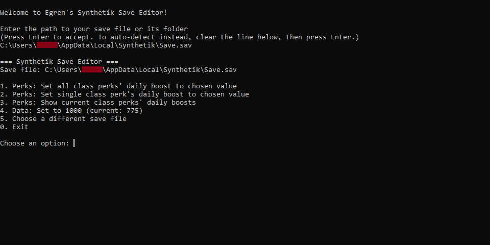

# Synthetik Save Editor

A simple command-line tool for editing **Synthetik** (Synthetik 1) save files on PC.



## No Python? Use the `.exe`

1. Download **`synthetik-save-editor.exe`** from the [latest release](https://github.com/EgrenB3S23/synthetik-save-editor/releases/latest).
2. Put it anywhere you like (Desktop, a folder next to your save, etc.).
3. Double-click it, or run from a terminal. Paste your save path when prompted.

   Or run with a path argument:

   ```console
   synthetik-save-editor.exe "C:\Users\<UserName>\AppData\Local\Synthetik"
   ```

Same menus and backups as the Python version. Windows 10/11, 64-bit.

GUI: `synthetik-save-editor.exe --gui`, or pick **Open graphical editor** from the menu.

---

## Or run from source (Python)

To run, run this in cmd or whatever flavor of shell you prefer:

```console
py main.py
```

or:

```console
python main.py
```

---

## Current features

- **Change daily module bonuses** to any number (all 62, one perk, or a random roll from `count:value` pairs).
- **View current perk boosts**.
- **Set data** (the `currency` resource) to a chosen value.
- **Loadout presets**: save one subclass's slots + tokens to a file in `loadouts/`, load it back, rename, delete.
- **Graphical editor** (`py main.py --gui`): clickable menu matching the CLI. The loadout card is one option; perk boosts, data, presets, backups, and viewing save loadouts are the others. The first time you open a loadout it can crop item/perk/weapon icons from your installed Synthetik `data.win` and cache them in `game_icons/` (not in git). To drop that feature later: delete `game_icons.py`, the `game_icons/` folder, and the few `game_icons` lines in `gui.py`.
- **Cheat levels** on each slot pick (Vanilla first, then widen that pick). The loadout is legal at the highest level any slot needs. Black squares on the card show that level. The game may still reset illegal loadouts.
- **Restore a backup** of the save the tool created.

---


## Before you start

1. **Close Synthetik**.
2. **Back up your save** yourself if you want extra safety — the tool also creates its own backup on every edit.
3. Find your save file. On Windows it is usually:

   `C:\Users\<YourUsername>\AppData\Local\Synthetik\Save.sav`

   When the tool starts, the path prompt is **pre-filled** with your last used path (if it still exists) or the usual Windows location. Press **Enter** to accept it. To **auto-detect** a different save file instead, clear the line and press **Enter** again. You can also pass a path on the command line, e.g. `py main.py "C:\Users\<YourUsername>\AppData\Local\Synthetik"`.

---


## How to use

You need **Python 3** installed. Check from a terminal:

```console
py --version
```

or

```console
python --version
```

If that works, download or clone this repo, open a terminal in the project folder, and run:

```console
py main.py
```

Follow the on-screen menu. On some systems the command may be `python main.py` instead of `py main.py`.

To open the window directly:

```console
py main.py --gui
```

Tip: make a *.bat file to avoid having to provide the savefile path every time you run the tool.
Example:
```bat
@echo off
cd /d "E:\synthetik-save-editor"
py main.py "C:\Users\<UserName>\AppData\Local\Synthetik\Save.sav"
```

[Official Python download page](https://www.python.org/downloads/)
(The tool was tested with [Python 3.13](https://www.python.org/downloads/latest/python3.13/) on Windows 10)

---

## Command-line interface

`main.py` (and the release `.exe`) is meant to be started by people **and** by other scripts. The way a path is passed has been stable since **v1.1**; wrappers such as a desktop `.bat` should keep working without changes.

### Invocation

```console
py main.py
py main.py "C:\Users\<UserName>\AppData\Local\Synthetik\Save.sav"
py main.py "C:\Users\<UserName>\AppData\Local\Synthetik"
py main.py --gui
py main.py --gui "C:\Users\<UserName>\AppData\Local\Synthetik\Save.sav"
```

| Argument | Meaning |
| --- | --- |
| *(none)* | Ask for a path (pre-filled). Then show the text menu. |
| `PATH` | A save file, or a folder that should contain `Save.sav`. On success, no path prompt. |
| `--gui` | Open the window after the save path is resolved. May appear anywhere among the arguments. |

### Path resolution

1. Existing directory → `Save.sav` in that folder.
2. Existing file named `Save.sav` → that file.
3. Existing file with another name → confirm `Y` / `N`, then use it if `Y`.
4. Anything else, including a missing `Save.sav` → invalid.

With **no** argument, the prompt is pre-filled with the last used path (if that file still exists) or `%LOCALAPPDATA%\Synthetik\Save.sav`. Enter accepts it. Clear the line and press Enter to auto-detect.

With a **path argument**, the tool uses it and does not prompt. If that path cannot be used, it prints an error, waits for Enter, and exits with status `1`. That is a caller error; pass a path that exists, or run with no argument to be prompted.

### Exit status

| Code | When |
| --- | --- |
| `0` | Normal exit from the menu, or the GUI window was closed. |
| `1` | A path was given on the command line and could not be used. |

The same contract is recorded for contributors in [AGENTS.md](AGENTS.md).

---


## Backups

Every time an edit is applied, the tool first makes a copy of the unedited savefile, adding a timestamp to the filename. Example:

`Save.backup.20260721_203812.sav`

Backups are created **next to the save file being edited**, with the same base name plus a timestamp. You can keep several backups at once. The CLI and the GUI can restore one of those files over the live save (the live file is backed up first).

---

## Changelog

### 1.2 (in progress, not a GitHub release yet)

* Loadout presets for one subclass at a time (slots + tokens).
* Graphical editor: loadout card, perk boosts, data, presets, backups.
* Perk boost randomize from a `count:value` list (reroll / accept / cancel).
* Restore a timestamped backup.
* Data can be set to any number, not only 1000.
* Token view shows item/weapon names from `obj_itemN` / `obj_weapon_*_N`.
* CLI: edit a single loadout slot from a filtered list.

### 1.1
* Now also supports changing the bonus for each perk individually.

## Dev stuff

Project files overview


| File           | Role                                         |
| -------------- | -------------------------------------------- |
| `main.py`      | Starts the program and shows the menu        |
| `gui.py`       | tkinter window (loadout / perks / data / presets / backups) |
| `loadouts.py`  | Read/write subclass loadouts and preset files |
| `catalog.py`   | Display names and loadout-pool lists         |
| `edits.py`     | Edit actions (perks, data, listings)         |
| `save_paths.py` | Find and remember save file locations          |
| `savefile.py`  | Read, write, and back up the save file       |
| `variables.py` | Perk names and other savefile variable names |

---


## Disclaimer

First off let me repeat from earlier:
The value here is probably more for me as a python exercise than for you as an impressive tool. **:shrug:**

This is an unofficial fanmade tool, not affiliated with the Synthetik developers. Editing save files can break progression or cause unexpected behaviour. This tool is admittedly very limited in scope, so any breakage would likely be easy to fix for someone who didn't really need this tool to begin with, except for convenience. Use at your own risk, and keep backups.

### Versions used during testing

- Synthetik: 26.1, on Steam. Latest as of 2026-07, and has been for about 5 years.
- Python: 3.13.5
- OS: Windows 10

---


## License

Do whatever you want! Steal it, modify it, stick it in a stew! Or rewrite it in Malbolge.