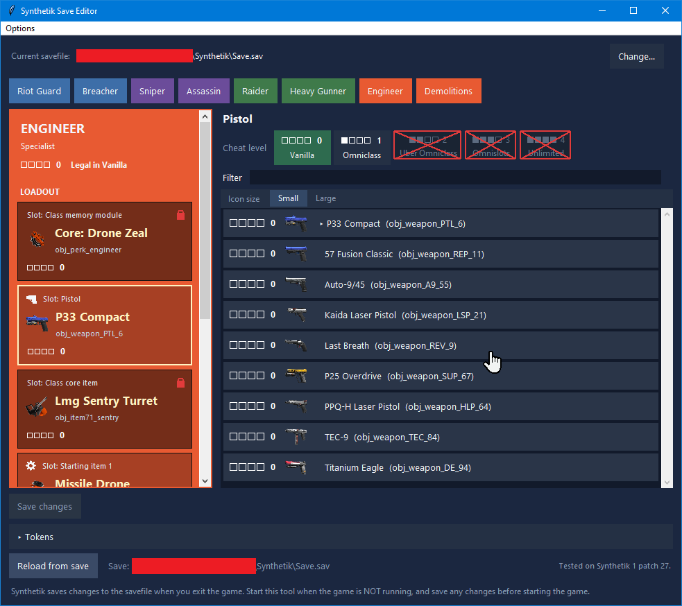

# Synthetik Save Editor

A save editor for **Synthetik** (Synthetik 1) on PC. Download the release and double-click `synthetik-save-editor.exe`. That opens the window. A text menu is in the same download if you want it. Compatibility tested against patch 27, and it should work at least as far back as patch 26.



## Ways to start

Download the release and double-click **`synthetik-save-editor.exe`**. That opens the window. No Python install, and no batch file.

The same download includes **`synthetik-save-editor-cli.exe`**. Double-click that one only if you want the numbered text menu instead.

Windows 10/11, 64-bit. A shortcut on the desktop can point at the exe. The 1.2 package is not on the [releases page](https://github.com/EgrenB3S23/synthetik-save-editor/releases/latest) yet. The file there today is version 1.1, which is the older text-menu program.

The window opens on the loadout card. **Options** on the menu bar has perk boosts, data, presets, backups, the daily run ticket, and starting Synthetik.

### The save file

The first start looks for `%LOCALAPPDATA%\Synthetik\Save.sav`. A window asks you to use that file or pick another. The choice is stored in `%APPDATA%\synthetik-save-editor\config.json`. Later starts use it while the file is still there. **Options → Choose a different save file**, **Change…** in the window, or text-menu option **6** picks a different one. Close Synthetik before you edit.

A path on the command line skips that question, for example `synthetik-save-editor.exe "C:\Users\<UserName>\AppData\Local\Synthetik"`. An old shortcut that already passes a save path keeps working. The full rules are in [Command-line interface](#command-line-interface) below.

### From the source folder

Use this when you have the project files and would rather not run a downloaded exe.

| Start this | What opens |
| --- | --- |
| `start.bat` | The window. If Python is missing, this downloads Python 3.13.5 from [python.org](https://www.python.org/downloads/) and installs it only for this tool, under `%LOCALAPPDATA%\synthetik-save-editor\`. |
| `cli.bat` | The text menu. Same Python setup as `start.bat`. |
| `py main.py` | The text menu, when Python is already installed. `py main.py --gui` opens the window. |
| `build_exe.bat` | Builds `dist\synthetik-save-editor.exe` and `dist\synthetik-save-editor-cli.exe` on this PC with [PyInstaller](https://pyinstaller.org/). The exe is a Windows launcher packed with a normal Python interpreter and this program. |

`editor.pyw` is the same window as `start.bat` on a PC where double-clicking a `.pyw` file already opens Python.

---

## Current features

- **Change daily module bonuses** to any number (all 62, or one perk).
- **View current perk boosts**.
- **Set data** (the `currency` resource) to a chosen value.
- **Daily run ticket** (`drun`): reset it to 1 so the once-a-day run is available again. Starting a run sets it to 0. The game normally writes 1 about 12 hours after the last login.
- **Loadout presets**: save one subclass's slots + tokens to a file in `loadouts/`, load it back, rename, delete.
- **Window:** the loadout card, plus **Options** on the menu bar for perk boosts, data, presets, backups, the daily run ticket, and starting the game. The first time you open a loadout it can crop item/perk/weapon icons from your installed Synthetik `data.win` and cache them in `game_icons/` (not in git). To drop that feature later: delete `game_icons.py`, the `game_icons/` folder, and the few `game_icons` lines in `gui.py`.
- **Cheat levels** on each slot pick (Vanilla first, then widen that pick). The loadout is legal at the highest level any slot needs. White squares on the card show that level. The game may still reset illegal loadouts.
- **Restore a backup** of the save the tool created.
- **Start Synthetik** from **Options**, or from text-menu option 11. Close the game again before the next edit.

---


## Before you start

1. **Close Synthetik**.
2. **Back up your save** yourself if you want extra safety — the tool also creates its own backup on every edit.
3. Find your save file. On Windows it is usually:

   `C:\Users\<YourUsername>\AppData\Local\Synthetik\Save.sav`

   How that file is chosen is under [The save file](#the-save-file) above.

---

## Command-line interface

`main.py` (and the release `.exe`) is meant to be started by people **and** by other scripts. The way a path is passed has been stable since **v1.1**; wrappers such as a desktop `.bat` should keep working without changes.

### Invocation

```console
py main.py
py main.py "C:\Users\<UserName>\AppData\Local\Synthetik\Save.sav"
py main.py "C:\Users\<UserName>\AppData\Local\Synthetik"
py main.py --gui
py main.py --gui "C:\Users\<UserName>\AppData\Local\Synthetik\Save.sav"
```

| Argument | Meaning |
| --- | --- |
| *(none)* | Use the remembered save if that file still exists. Otherwise confirm the auto-found `Save.sav`, or pick one in the Windows file window. Then show the text menu. |
| `PATH` | A save file, or a folder that should contain `Save.sav`. On success, no path prompt. |
| `--gui` | Open the window after the save path is resolved. May appear anywhere among the arguments. |

### Path resolution

1. Existing directory → `Save.sav` in that folder.
2. Existing file named `Save.sav` → that file.
3. Existing file with another name → confirm `Y` / `N`, then use it if `Y`.
4. Anything else, including a missing `Save.sav` → invalid.

With **no** argument, a remembered save in `%APPDATA%\synthetik-save-editor\config.json` is used when that file still exists. Otherwise the tool looks for `%LOCALAPPDATA%\Synthetik\Save.sav` and asks you to accept it or pick another file. Cancelling that window exits without editing.

With a **path argument**, the tool uses it and does not ask. If that path cannot be used, it prints an error, waits for Enter, and exits with status `1`. That is a caller error. A desktop `.bat` that already passes a save path keeps working.

### Exit status

| Code | When |
| --- | --- |
| `0` | Normal exit from the menu, or the GUI window was closed. |
| `1` | A path was given on the command line and could not be used. |

The same contract is recorded for contributors in [AGENTS.md](AGENTS.md).

---


## Backups

Every time an edit is applied, the tool first makes a copy of the unedited savefile, adding a timestamp to the filename. Example:

`Save.backup.20260721_203812.sav`

Backups are created **next to the save file being edited**, with the same base name plus a timestamp. You can keep several backups at once. The CLI and the GUI can restore one of those files over the live save (the live file is backed up first).

---

## Changelog

### 1.2 (in progress, not a GitHub release yet)

* Loadout presets for one subclass at a time (slots + tokens).
* Graphical editor: loadout card, perk boosts, data, presets, backups.
* Restore a timestamped backup.
* Data can be set to any number, not only 1000.
* Token view shows item/weapon names from `obj_itemN` / `obj_weapon_*_N`.
* CLI: edit a single loadout slot from a filtered list.

### 1.1
* Now also supports changing the bonus for each perk individually.

## Dev stuff

Project files overview


| File           | Role                                         |
| -------------- | -------------------------------------------- |
| `main.py`      | Text menu and the save-path rules            |
| `editor.pyw`   | Opens the window with no console             |
| `start.bat`    | Opens the window. See [Ways to start](#ways-to-start) |
| `cli.bat`      | Opens the text menu. See [Ways to start](#ways-to-start) |
| `ensure_python.ps1` | Installs the official Python for this tool only |
| `build_exe.bat`| Builds the Windows exe from these scripts    |
| `gui.py`       | tkinter window (loadout / perks / data / presets / backups) |
| `loadouts.py`  | Read/write subclass loadouts and preset files |
| `catalog.py`   | Display names and loadout-pool lists         |
| `edits.py`     | Edit actions (perks, data, listings)         |
| `save_paths.py` | Find and remember save file locations          |
| `savefile.py`  | Read, write, and back up the save file       |
| `variables.py` | Perk names and other savefile variable names |

---


## Disclaimer

First off let me repeat from earlier:
The value here is probably more for me as a python exercise than for you as an impressive tool. **:shrug:**

This is an unofficial fanmade tool, not affiliated with the Synthetik developers. Editing save files can break progression or cause unexpected behaviour. This tool is admittedly very limited in scope, so any breakage would likely be easy to fix for someone who didn't really need this tool to begin with, except for convenience. Use at your own risk, and keep backups.

### Versions used during testing

- Synthetik 1: compatibility tested against patch 27. Earlier testing was on patch 26.1. Should also work at least as far back as patch 26.
- Python: 3.13.5
- OS: Windows 10

---


## License

Do whatever you want! Steal it, modify it, stick it in a stew! Or rewrite it in Malbolge.